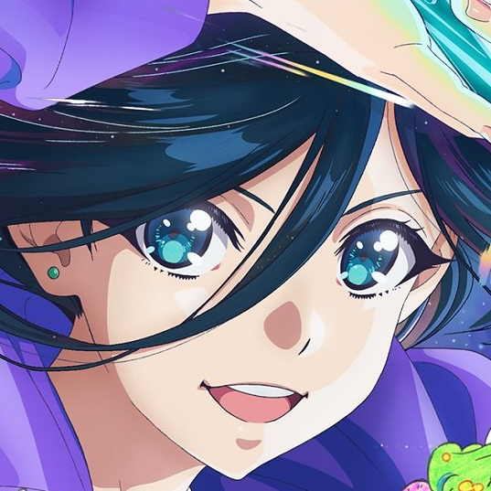

# Natsuko

### 把图片、文档和动图，处理成你想要的样子。

拼接照片、裁去截图黑边、转换 PDF，或把一段视频做成 GIF。 
从首页选一个功能，也可以从其他应用直接分享过来。

**Android 16 及以上** · 简体中文 / 繁體中文 / 한국어 / 日本語 / English

**[快速开始](#快速开始)** &nbsp;·&nbsp; **[主要功能](#主要功能)** &nbsp;·&nbsp; **[文档](#文档)** &nbsp;·&nbsp; **[更新记录](CHANGELOG.md)** &nbsp;·&nbsp; **[最新 Release](https://github.com/poppinzhang/Natsuko/releases/latest)**

## 快速开始

Natsuko 是一款 Android 图片、PDF 与视频处理工具。安装 APK 后，本地处理功能即可使用，无需另装工具或下载编解码器。系统需要 **Android 16 或更新版本**。

1. **选择功能。** 首页直接列出各项功能，点选你要完成的操作。
2. **导入文件。** 从系统选择器选取图片、PDF 或视频；下载 X / Twitter 视频时，粘贴推文链接。
3. **处理并查看结果。** 按需要调整选项后开始处理，完成后可以打开、保存或分享成品。批量处理会显示进度；如果部分文件失败，可以查看各自的原因和已完成的结果。

**刚截完图，想去掉黑边？** 在截图或相册的分享面板中选择 Natsuko 的「去除黑边」，应用会直接开始处理。全部成功后返回首页，点「查看结果」即可查看和分享裁好的图片。

其他功能也有各自的系统分享入口，选中后直接进入对应流程，无需回到首页重新选择文件。

安装版本可在首页底部的「关于」中查看。各版本变化见[更新记录](CHANGELOG.md)。

## 主要功能

| 功能 | 可以做什么 |
| :-- | :-- |
| 图片拼接 | 把多张图片横向、纵向或按网格拼在一起，拖动调整顺序，自选留白颜色，预览整体效果。 |
| 去除黑边 | 自动裁去图片四周连续的完整黑边，支持批量处理，保存为 PNG。 |
| 图片调整 | 裁剪、拉直、旋转、镜像或缩小图片；支持撤销与重做，导出 PNG、JPEG 或 WebP，并在保存前查看预计文件大小。 |
| 图片转 PDF | 把多张图片合成一份 PDF，或每张分别生成一份；可调整纸张、方向和页边距。 |
| PDF 转图片 | 一次选择多份 PDF，将页面转成 PNG 或 JPEG，并选择输出清晰度。 |
| 视频转 GIF | 从 MP4、MKV、MOV、WebM 等常见视频制作动图，调整帧率、采样间隔、尺寸和循环次数。 |
| 下载推特视频（GIF） | 输入或分享公开 X / Twitter 推文链接，下载其中可获取的视频与动图，并可继续转成 GIF。 |
| 复制图片位置 | 把一张照片的坐标和地点名称批量复制到其他照片，保留原图并生成同格式副本；已有位置时由你决定是否覆盖。 |

X 上的动图下载后保存为 MP4；需要 GIF 文件时，在结果页点「视频转 GIF」即可，无需重新选择视频。私密、已删除或受访问限制的推文可能无法下载，公开内容也可能受接口变化影响。

当 X 明确提示视频需要登录查看时，Natsuko 会询问是否登录 X，取得登录态后重试。删除、作者限制可见或无法确认原因的情况直接报告错误。下载页也提供「登录 X」入口，可由你主动登录后再尝试原因不明的链接；登录不能保证可访问，也不能恢复已删除内容或改变账号权限。详见[登录与访问限制](docs/download_twitter_video.md#登录与访问限制)。

使用带 `/video/序号` 的链接时，多视频推文可选择只下载当前视频或下载全部视频，详见[下载范围说明](docs/download_twitter_video.md)。

## 成品保存在哪里？

默认保存在 **Natsuko 的应用专属目录**，处理完成后可以直接打开或分享。

如果希望在文件管理器中找到成品，在**设置 → 保存至用户存储目录**中打开开关。之后的成品会自动保存到 `Download/Natsuko` 下对应功能的文件夹，也可以自行选择保存目录。

忘记提前打开开关也没关系：在结果页开启它，就会补存本次成品，并为后续处理保留这个设置。保存失败时会说明原因，可以重试。

**卸载应用会移除应用专属副本。** 保存到用户目录的文件可以继续保留，需要长期保存的成品请先存到该目录。

## 用起来更顺手

在设置中选择简体中文、繁体中文、韩语、日文或英文，也可以跟随系统语言；全部语言可离线切换。外观支持浅色、深色和跟随系统，选择会在下次打开时保留。

首页支持长按卡片、上下拖动，把常用功能放在前面；顺序会自动保存，也支持通过 TalkBack 的「上移 / 下移」操作调整。

在**设置 → 应用更新**点「检查更新」，有新版本时确认后自动下载并安装，完成后重新打开应用即可。首次更新时，系统会请你允许 Natsuko 安装应用。旧版没有此入口时，需先从 [GitHub Releases](https://github.com/poppinzhang/Natsuko/releases/latest) 手动安装支持应用内更新的版本。

## 隐私与网络

图片、PDF 和 GIF 转换在设备本地完成，不上传你的本地媒体。视频处理所需组件随应用安装，可离线使用。

下载 X / Twitter 视频需要联网，通过 HTTPS 访问 X 官方接口、网页和视频服务器，不使用第三方解析站。公开内容默认不登录。可选登录功能在 X 官方登录页完成，密码由 X 处理；Natsuko 仅在本次应用会话中保留必要登录态，下载页可清除登录态。登录网页数据在打开与关闭时清理，并排除在系统备份之外。

检查更新只在你点击时访问 GitHub，查询并下载本项目发布的安装包；不会在后台自动检查，也不发送账号或设备信息。

导入文件使用系统选择器或分享面板。保存到默认 Download 目录无需授予全盘存储权限；选择其他保存目录时，由系统目录选择器授权。

## 文档

| 文档 | 内容 |
| :-- | :-- |
| [更新记录](CHANGELOG.md) | 已发布与未发布的变化 |
| [保存与输出](docs/output_storage.md) | 保存位置、目录授权和失败重试 |
| [图片拼接](docs/image_merge.md) · [去除黑边](docs/crop_black_border.md) · [图片调整](docs/image_adjustment.md) | 图片处理的选项与限制 |
| [图片转 PDF](docs/image2pdf.md) · [PDF 转图片](docs/pdf2image.md) | 文档转换的选项与限制 |
| [视频转 GIF](docs/video2gif.md) · [下载推特视频](docs/download_twitter_video.md) | 视频格式、转换参数与下载范围 |
| [复制图片位置](docs/copy_location.md) | 支持的图片格式与位置冲突处理 |
| [语言设置](docs/i18n.md) · [外观](docs/appearance.md) · [首页排序](docs/home_feature_order.md) | 界面偏好与操作方式 |
| [应用更新](docs/app_update.md) | 检查、下载与安装新版本的方式和限制 |
| [开发指南](AGENTS.md) | 环境准备、测试、构建与维护约定 |

## 名字与开源许可

Natsuko 的名字来自动画《全修。》（ZENSHU）的主人公 **Natsuko Hirose（広瀬ナツ子）**，希望像「全修」一样，为图片提供多种重新创作的可能。

项目原创代码采用 [Apache License 2.0](LICENSE)，适用范围见 [NOTICE](NOTICE)。第三方组件保留各自的许可，可在应用的「关于」中离线阅读，也可查看[第三方开源声明](THIRD_PARTY_NOTICES.md)。

角色图像及其派生图标不属于 Apache 授权范围；本仓库不授予这些图像的再分发权利。
